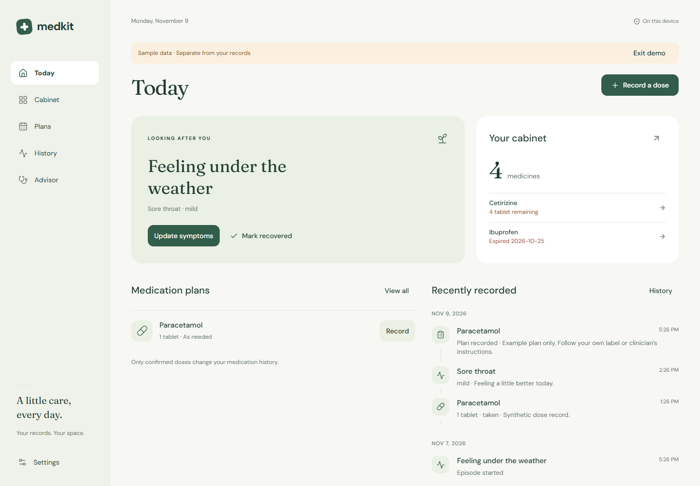

# MedKit

Your medicine cabinet, actual doses, and health history, in one calm space.

MedKit is a local-first Expo application for responsive Web, iOS, and Android. The initial implementation works without an account, AI credentials, or a backend. It is a personal recordkeeping application, not a diagnostic or prescribing system.



## What works

- Add, edit, search, and archive medicines, including Chinese names and combination ingredients.
- Manage separate batches, expiry dates, locations, stock thresholds, and intentional stock adjustments.
- Record scheduled or as-needed plans. Pause, resume, complete, or discontinue a plan.
- Confirm actual doses, missed or skipped scheduled doses, and corrections. Only explicit consumption changes stock.
- Track overlapping health episodes, dated symptoms, consultations, reported diagnoses, and recovery in one timeline.
- Export all records as JSON or a readable consultation summary. Delete local records with confirmation.
- Use light, dark, and system themes. Explore synthetic examples in a separate database.
- Review local checks for expiry, duplicate recorded ingredients, incomplete context, and changed formulations.
- Give a local MCP client scoped, expiring, read-only access to an explicitly exported snapshot.
- Run an optional connected Web server with OAuth-protected HTTP MCP, shared server records, and owner-confirmed change requests. Deploy on [Cloudflare Workers + D1](docs/DEPLOYMENT.md), or use the [local Node server](docs/INTEGRATIONS.md#connected-web-and-http-mcp).

The advisor abstains from selecting treatment. No comprehensive drug-interaction database or live model provider is connected.

## Run locally

Use Node.js 24 and npm. The lockfile is committed.

```sh
npm ci
npm run web
```

For the production Web build, including offline startup:

```sh
npm run build:web
npm run preview
```

Open `http://127.0.0.1:4173`. The preview server binds only to the local machine. Offline use requires a successful first load and a browser that permits service workers and IndexedDB. Development mode does not install the offline shell.

For native development:

```sh
npm start
# With the relevant simulator or emulator installed:
npm run ios
npm run android
```

Use an Expo Go or development-build environment compatible with SDK 58. Native JavaScript/Hermes bundles have been exported, but native device behavior has not been verified. Store distribution, signing, application IDs, and releases are not configured.

## Verify

```sh
npm run verify
npx playwright install chromium
npm run test:e2e
npm run build:native
npm audit --omit=dev
```

`verify` runs strict type checking, formatting checks, unit/integration tests, the Web build, and compiled Worker/D1 integration tests. Browser tests use only synthetic data. Set `PLAYWRIGHT_CHROMIUM_EXECUTABLE` to use an existing compatible Chromium installation. A native bundle export is not a native application build or a device test.

See [verification evidence](docs/VERIFICATION.md), [integration instructions](docs/INTEGRATIONS.md), and the [cloud deployment guide](docs/DEPLOYMENT.md).

## Your records

By default, Web records remain in this browser's IndexedDB and native records use local SQLite. The optional connected Web mode stores records on your configured server and downloads a separate offline copy. Uploading local records requires explicit selection and an empty connected account. Connected writes require a network connection; native databases and separate local Web records are not synchronized. MedKit does not provide application-level database encryption or managed backups. Browser cleanup or uninstalling the application can remove records. Keep sensitive exports outside this repository.

Local deletion removes records from the active local database. It does not securely erase physical storage or recall exports and external-client responses. Demo records are synthetic and use a separate database.

Local mode sends no health records to a model or remote service. Connected mode sends records to the server you sign in to. If you configure an external MCP client, that client controls whether it sends returned records to its own provider. Read [security and privacy boundaries](SECURITY.md) first.

## Project information

- [Architecture](docs/ARCHITECTURE.md)
- [Product and reference research](docs/RESEARCH.md)
- [Agent guide](docs/AGENT_GUIDE.md)
- [AGPL-3.0 license](LICENSE)

Not yet verified or provided: production hosting, a live ChatGPT/OpenClaw connection, native account synchronization, offline write merging, account recovery UI, live AI providers, reminders, packaging photos/OCR, multilingual UI, and native device testing.
